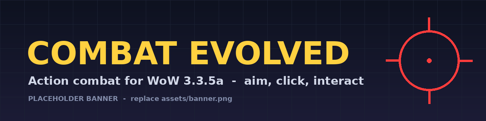
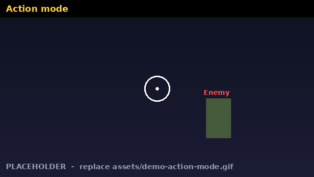
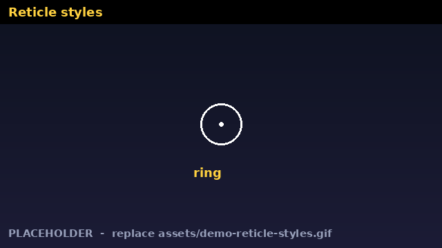
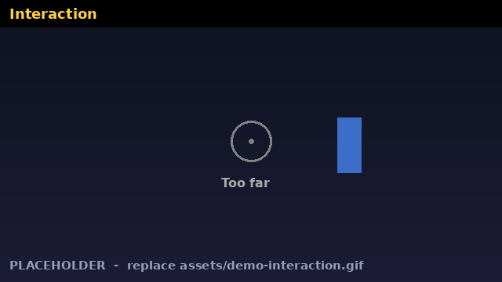
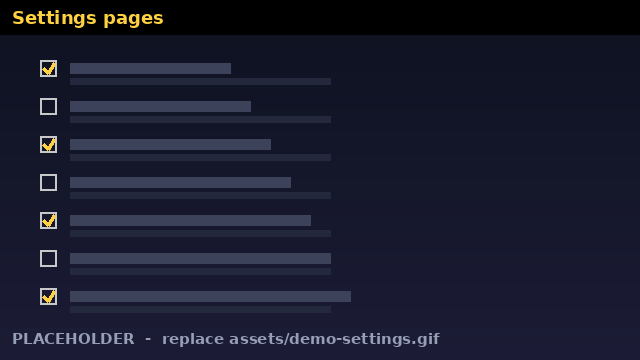

# Combat Evolved

**Action combat for World of Warcraft 3.3.5a (WotLK).**
Press **middle mouse** to swap between normal tab-targeting and an action-combat mode: your cursor disappears, the camera follows your mouse like holding right-click, a reticle appears, and your mouse buttons fire your action bar.

> Formerly "ActionCombat". Built for the 3.3.5a (build 12340) client. Tested on Warmane-style 3.3.5a clients; other 3.3.5a servers should work but are not verified.

  
  

---

## Short description (for a post)

Combat Evolved turns WotLK into an action-combat game. Middle mouse toggles a mouselook mode with a reticle: left click casts action button 1, right click casts button 2. Aim at an enemy's nameplate and the reticle turns red; aim at a friendly NPC and it turns green; aim at loot and it turns blue. One key (F) targets and interacts with quest givers, loots corpses and opens chests. It adds 16 reticle styles, hit/crit/kill markers, range and cooldown rings, a cast arc, immersion options (auto-enter on combat, fade the interface out of combat, separate mouse sensitivity) and sound cues. Everything is configurable under **Interface > AddOns > Combat Evolved**, and every setting has a description.

---

## Features

### Core action mode
- **Middle mouse** toggles the mode on and off (secure binding, works in combat).
- **Mouselook camera**: the cursor is hidden and the character turns as you move the mouse.
- **Left click = action button 1, right click = action button 2** (any of buttons 1-12, configurable).
- **Optional auto-attack** on left and/or right click.
- **Fire on mouse down or up.**
- **Hold ALT** to get your cursor back at the reticle with normal clicks.
- **Cursor returns automatically** while windows are open (bags, quests, vendors, etc.) and mouselook resumes when they close.
- **Nearest-enemy fallback**: with nothing targeted, a click can grab the nearest enemy in front of you.

### Aiming and targeting
- **Nameplate aiming**: the addon reads nameplates to know what is under the reticle (works without any mouseover support).
- **Reticle colors**: red = enemy, yellow = neutral, green = friendly, blue = lootable corpse, grey = tapped/dead, white = nothing aimed. All colors are editable.
- **Click targeting modes** (one cycle button):
  - Target the aimed enemy, then fire
  - First click selects, next click fires (click-to-select)
  - Fire only (never changes target)
  - Plain bindings (buttons bound straight to the action bar)
- **Click-to-select** retargets with exact-name matching and falls back to the game's mouseover if no plate is found.
- **Friendly-target key (default G)** targets friendly players (or friendly NPCs, optional); aiming at a player's nameplate targets that exact player.

### Interaction (default key F)

- **Classic**: F is the game's "Interact With Target".
- **Smart**: aim at a friendly NPC (quest giver, vendor, guard); the first press targets it, the next press interacts. If it is already targeted, or you just killed it, F interacts immediately.
- **Smart + double-press loot**: with nothing aimed, the first F frees the cursor at the reticle position and the second F is "Interact With Mouseover" - works on corpses, chests, herbs, ore and quest objects.
- **World click**: with nothing aimed (out of combat), the first left click frees the cursor at the reticle and the second is the game's real click. Aim at an enemy or be in combat and left click casts again. Optionally also for friendly units.

### Nameplates and names
- **Names above units**, one cycle button:
  - *Normal nameplates* (as the game draws them)
  - *Plate names only* (health bars, borders, glow and level hidden; the name stays; text color and size adjustable)
  - *Game's own names* (the original 3D names above characters, in the game's own color and size; nameplates are turned off in this mode and aiming then uses the game's mouseover)
- **Hide enemy / friendly nameplates** independently while in the mode.
- Hidden plates are still used internally for aiming. Everything is restored when you leave the mode.
- Fixes for the client not redrawing names: the addon pulses the relevant settings on entering the mode and keeps them healed, so you do not need to press V.

### Reticle (16 styles)
Classic lines, dot, cross (gap), plus, ring, ring + dot, double ring, crosshair, scope, dashed ring, arcs, corner brackets, rounded square, diamond, chevrons, four dots.
- Pick the style from a **thumbnail grid** with a live preview.
- **Per-state colors** with a color picker, and **separate opacity** for "nothing aimed" and "target aimed".
- **Lock-on animation**: the reticle tightens and flashes when it snaps onto a target.
- **Mini health bar** of the aimed target, **target name**, and an **interact hint** ("[F] Loot" / "[F] Talk").
- **Position**: follow the frozen pointer, or fixed at screen center with horizontal/vertical offset sliders. Adjustable size.

### Combat feedback
- **Hit marker**, **gold critical marker**, **red kill marker** (marker size adjustable, with test buttons).
- **Out-of-range tint**: the reticle turns purple when your hostile target is out of range of your left-click button.
- **Interact-range grey-out**: the reticle turns grey and shows "Too far" when a quest giver or lootable is out of interact range (about 10 yards, using units you have targeted or moused over).
- **Cooldown ring** for the left-click button (white = global cooldown, orange = real cooldown).
- **Cast / channel arc** around the reticle.

### Immersion
- **Auto-enter action mode when combat starts**, and **leave when combat ends** (only if it entered by itself). Uses a secure state driver, so it works mid-fight.
- **Leave on mount, return on dismount.**
- **Fade action bars and unit frames out of combat** (adjustable opacity); they return in combat.
- **Separate mouse sensitivity** in action mode.
- **Floating combat text on** in action mode.
- Camera: **set a camera distance** for the mode (0 = first person), zoom buttons, max zoom-out factor, field of view, and camera distance restored when you leave.
- **Fade chat, minimap and quest tracker** while in the mode.
- All temporary changes (sensitivity, combat text, names, nameplates) are **restored when you leave the mode**, and again at next login if the game closed while the mode was on.

### Sound cues
Seven events, each with its own sound picked from 17 built-in game sounds (or Off), with a preview when you choose:
mode on, mode off, lock-on to an enemy, lock-on to a friendly, hit, critical hit, killing blow.

### Settings UI

- Six pages under **Interface > AddOns > Combat Evolved**: *Combat Evolved* (main), *Targeting & Plates*, *Position & Tests*, *Reticle Look*, *Combat Feedback*, *Immersion*.
- Every setting has a description. Settings that override each other are grouped into cycle buttons.
- **Defaults** button in the Interface Options window (or `/acm reset`) restores the built-in defaults.
- **Silent by default**: no chat spam. Chat messages, on-screen ON/OFF text and a click trace can be turned on in the Messages section.

---

## Installation

1. Download the latest release zip.
2. Extract so you have `Interface\AddOns\CombatEvolved\CombatEvolved.toc`.
3. Remove the old `ActionCombat` folder if you had it (both loaded together will fight over middle mouse).
4. To keep your settings from ActionCombat, copy `WTF\Account\<ACCOUNT>\SavedVariables\ActionCombat.lua` to `CombatEvolved.lua` in the same folder before logging in.
5. Start the game and open **Interface > AddOns > Combat Evolved**.

## Quick start

1. Press **middle mouse** to enter action mode.
2. Put your spells on action bar buttons **1** and **2**.
3. Aim at an enemy (reticle turns red) and click.
4. Press **F** near quest givers and loot; **G** to target a friendly player.
5. Hold **ALT** whenever you need the cursor.

---

## Slash commands

| Command | What it does |
|---|---|
| `/acm`, `/ce`, `/combatevolved` | Open the settings |
| `/acm look` / `feedback` / `immersion` | Open that page |
| `/acm interaction` | Open Targeting & Plates |
| `/acm reticle` | Open Position & Tests |
| `/acm reset` | Restore the default settings |
| `/acm fmode classic\|smart\|loot` | Set the F key mode |
| `/acm interact target\|mouseover` | Choose what F interacts with |
| `/acm friend <0-1>` | Friendly nameplate opacity in the mode |
| `/acm worldclick` | Toggle left-click-at-reticle |
| `/acm trace` | Log every click to chat (debug) |
| `/acm debug` | Print the current state |
| `/acm probe` | Report which extra functions this client has |
| `/acm hovertest` | Test whether the game updates mouseover while mouselooking |
| `/acm keytest` | Diagnose the F and G keys |

---

## Compatibility and limits

- **Client:** WoW 3.3.5a (build 12340). Uses only 3.3.5a functions; optional ones are guarded.
- **Combat lockdown:** the game does not allow addons to retarget or rebind keys in combat, so click targeting, rebinding F, and similar changes happen out of combat. Auto-enter on combat works because it uses Blizzard's secure state drivers.
- **No automation:** every click presses one action button. The addon does not play your rotation.
- **Nameplate addons** (ElvUI, TidyPlates, etc.) replace the default plate structure, so reticle colors and click targeting that depend on plates will not work with them. Turn off *Nameplate aiming* in that case.
- **Action-bar addons** (Bartender, ElvUI bars) generally work because the addon uses the default action button IDs, but the interface fade only touches the default Blizzard bars.
- **Game's own names mode** turns nameplates off, so aiming relies on the game's mouseover (check `/acm hovertest`).
- **Over-the-shoulder camera offset** is not supported by the 3.3.5a client.
- **Another addon on middle mouse** will conflict.
- Other 3.3.5a servers (including custom forks) should work but are not verified.

## Performance

Idle (mode off) cost is minimal. In the mode, the reticle and nameplate scan run about 20 times a second, and the nameplate hide loop runs per frame over known plates. Memory is small (about 130 KB of textures). Report any FPS drops with where they happen.

## Troubleshooting

- **Nothing happens on middle mouse:** check another addon is not using the button; `/acm debug` shows what MMB is bound to.
- **Click does not target:** make sure *Plain bindings* is not selected and *Nameplate aiming* is on. Turn on *Log every click to chat* (Messages) to see what each click did.
- **Names missing or grey:** switch *Names above units* to another option, or *Names-only text color* to reaction colors.
- **Cursor stuck free:** a window may be open; close it or press the toggle again.

## Reporting bugs

Please include: your server and client version, other addons loaded, the output of `/acm debug` and `/acm probe`, and what you expected to happen.

## License

Add your license here.
